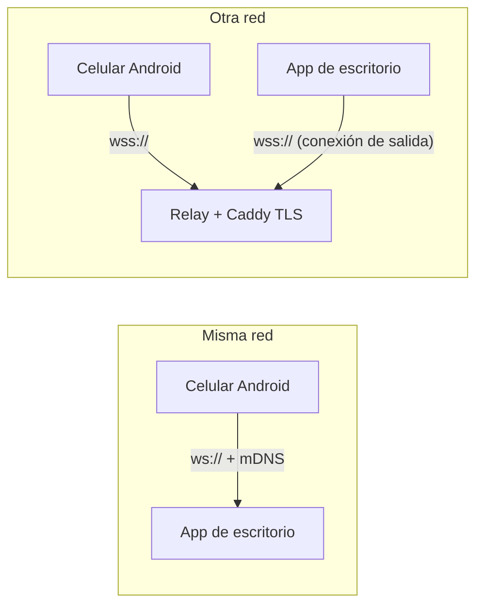

# Control Remoto

Controla tu PC con Windows desde el celular Android: **ver la pantalla en tiempo real, mover el mouse como un
touchpad, escribir, escuchar el sonido del PC** y hacerlo tanto en la misma red como por internet, con
vinculación segura de dispositivos.

> **English:** Android + Windows remote desktop built from scratch: real-time screen streaming (JPEG over
> WebSockets, 20–30 FPS), touch gestures, keyboard, PC audio capture (WASAPI loopback), mDNS discovery,
> token-based device pairing with on-PC approval, and an optional TLS relay to connect from any network
> without opening ports.

<!-- Agrega capturas en docs/img/ y descomenta:


-->

## Características

**En el celular (Android)**
- Pantalla del PC en vivo, con **calidad y FPS configurables** (hasta 20–30 FPS en calidad Máxima sobre Wi‑Fi).
- Gestos tipo touchpad: un dedo mueve, tocar hace clic; dos dedos: clic derecho, scroll y zoom que sigue al cursor.
- Cursor propio, grande y visible; **modo pantalla completa** horizontal.
- Teclado con texto (tildes y ñ) y teclas especiales (Esc, Tab, Alt+Tab, Ctrl+C/V…); arrastrar y soltar.
- **Sonido del PC** en el celular (calidad normal o estéreo).
- Reconexión automática y cambio entre Wi‑Fi y datos móviles; DNS de respaldo sobre HTTPS.

**En el PC (Windows)**
- App con ventana y bandeja del sistema: PIN de vinculación, dispositivos vinculados, aviso de quién está conectado.
- Controles de seguridad: aprobar, desconectar, **bloquear acceso**, revocar, modo **solo ver**.
- Instalador (`.exe`) con regla de firewall solo para redes privadas, inicio con Windows e instancia única.

**Por internet (opcional)**
- **Relay** propio con HTTPS: el PC se conecta hacia afuera, **sin abrir puertos** en el router.

## Arquitectura



Más detalle y diagramas de secuencia en [`docs/ARQUITECTURA.md`](docs/ARQUITECTURA.md).

## Seguridad

Vinculación con PIN de un solo uso **y** aprobación en el PC, tokens cuyo hash es lo único que guarda el PC,
cifrado de credenciales en el celular con Android Keystore, bloqueo por intentos fallidos y rechazo de conexiones
directas fuera de la red local. Modelo completo y **limitaciones conocidas** (por ejemplo, la red local aún no va
cifrada) en [`docs/SEGURIDAD.md`](docs/SEGURIDAD.md).

## Tecnologías

| Parte | Stack |
|---|---|
| Android | Kotlin, Jetpack Compose, OkHttp (WebSocket), AudioTrack, NsdManager, Android Keystore |
| PC | Python 3, asyncio, websockets, mss, Pillow, pyautogui, pynput, soundcard, zeroconf, customtkinter, pystray |
| Relay | Python, websockets, Caddy (Let's Encrypt), systemd, Oracle Cloud |
| Empaquetado | PyInstaller, Inno Setup |

## Cómo ejecutarlo

### App del PC (Windows, Python 3.10+)
```bash
cd desktop
pip install -r requirements.txt
python app.py
```
Pulsa **Vincular nuevo dispositivo** para ver el PIN. Para crear el instalador: `build_exe.bat` y luego compila
`installer.iss` con Inno Setup 6.

### App Android
Abre la carpeta `android/` con Android Studio y ejecútala en tu celular (Android 7.0+). En la app, toca
**Vincular**, deja la IP vacía (la busca por mDNS) y escribe el PIN. PC y celular deben estar en la misma Wi‑Fi
la primera vez.

### Acceso por internet (opcional)
Despliega el relay siguiendo [`relay/README.md`](relay/README.md) y crea `%APPDATA%\ControlRemoto\config.json`
(ejemplo en `desktop/config.example.json`). Tras conectar una vez en la red local, el celular aprende la dirección
del relay automáticamente.

## Estructura

```
control-remoto/
├── android/     App Android (Kotlin + Compose)
├── desktop/     App de escritorio y servidor (Python)
├── relay/       Relay para acceso por internet + archivos de despliegue
└── docs/        Arquitectura y modelo de seguridad
```

## Hoja de ruta

- [ ] Cifrado (TLS) también en la red local, con *certificate pinning*
- [ ] Vinculación escaneando un código QR
- [ ] Cliente web para cualquier celular (incluido iPhone)
- [ ] Cifrado de extremo a extremo a través del relay
- [ ] Pruebas automatizadas en el repositorio y CI
- [ ] Firma digital del instalador

## Uso responsable

Úsalo solo en equipos que sean tuyos o donde tengas autorización. Este proyecto es educativo y se ofrece sin
garantía.

## Licencia

[MIT](LICENSE)
