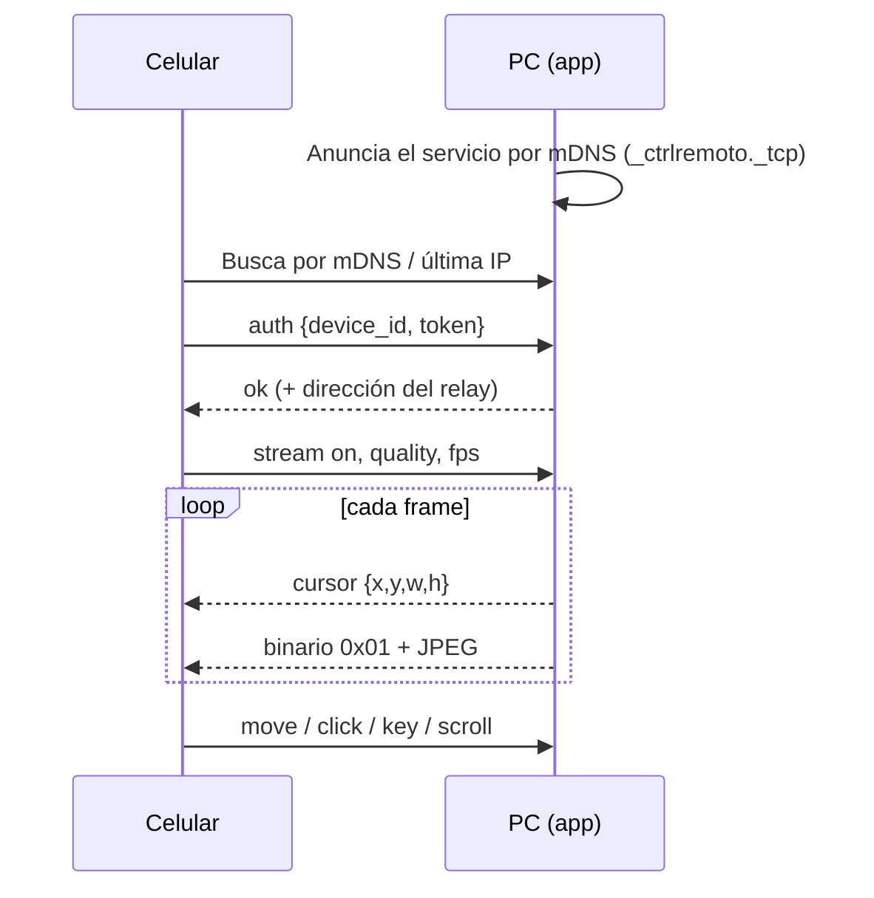
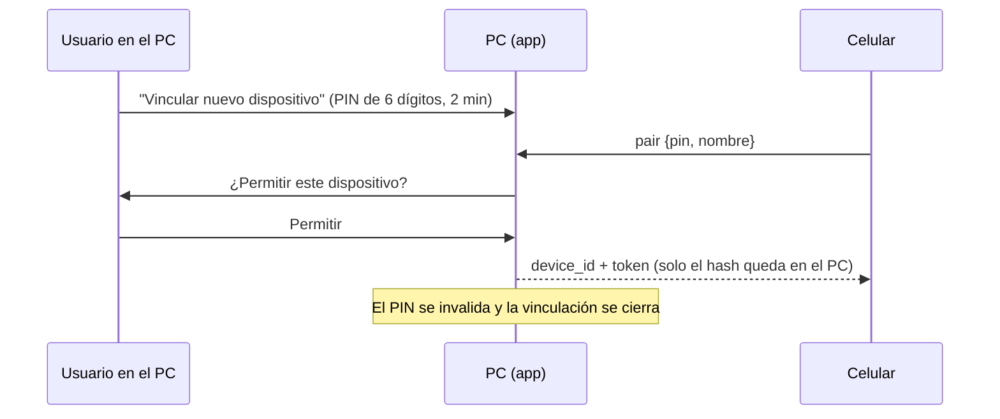
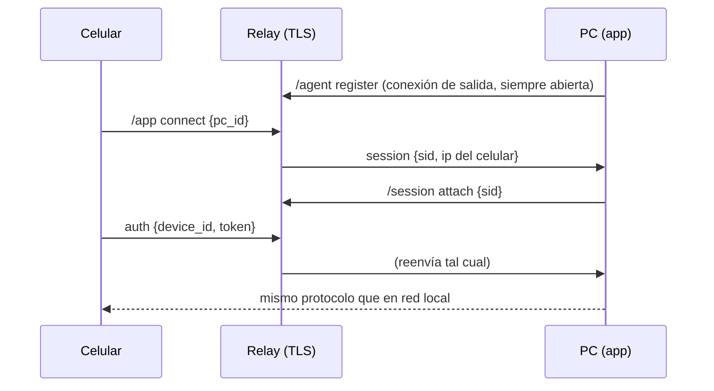

# Arquitectura

## Componentes

| Componente | Tecnología | Función |
|---|---|---|
| App Android | Kotlin, Jetpack Compose, OkHttp, AudioTrack, NsdManager | Pantalla remota, gestos, teclado, sonido |
| App de escritorio (Windows) | Python, asyncio/websockets, customtkinter, pystray | Servidor, ventana de control, bandeja |
| Relay | Python, websockets, Caddy, systemd | Acceso desde otras redes sin abrir puertos |
| Instalador | PyInstaller, Inno Setup | `.exe` con regla de firewall para redes privadas |

## Flujo: red local

## Flujo: vinculación (solo red local)

## Flujo: por internet (relay)

## Protocolo (JSON por WebSocket, más mensajes binarios)

**Celular → PC:** `pair`, `auth`, `move`, `click` (botón, clics), `down`/`up`, `scroll`, `text`, `key`,
`stream` (on), `quality` (preset), `fps` (valor), `audio` (on, preset).

**PC → celular:** respuestas `{ok, code, error}`, `cursor {x,y,w,h}`, `audio_format {rate,channels}`,
`audio_error {message}`.

**Binarios:** el primer byte es la etiqueta: `0x01` = imagen JPEG, `0x02` = audio PCM de 16 bits.

## Decisiones de diseño

- **El cursor se dibuja en el celular**, con la posición real enviada aparte: la captura de pantalla no lo incluye
  y así se puede agrandar y hacer zoom que sigue al cursor.
- **Relé sin estado de seguridad:** el relay solo reenvía; la autenticación ocurre en el PC.
  Un relay comprometido no puede suplantar a un celular vinculado.
- **Fallback de DNS sobre HTTPS** en Android: si el operador móvil no resuelve el dominio del relay, la app lo
  resuelve consultando a Cloudflare y Google por IP.
- **Captura de audio** por loopback WASAPI en un hilo propio con COM inicializado por hilo.
